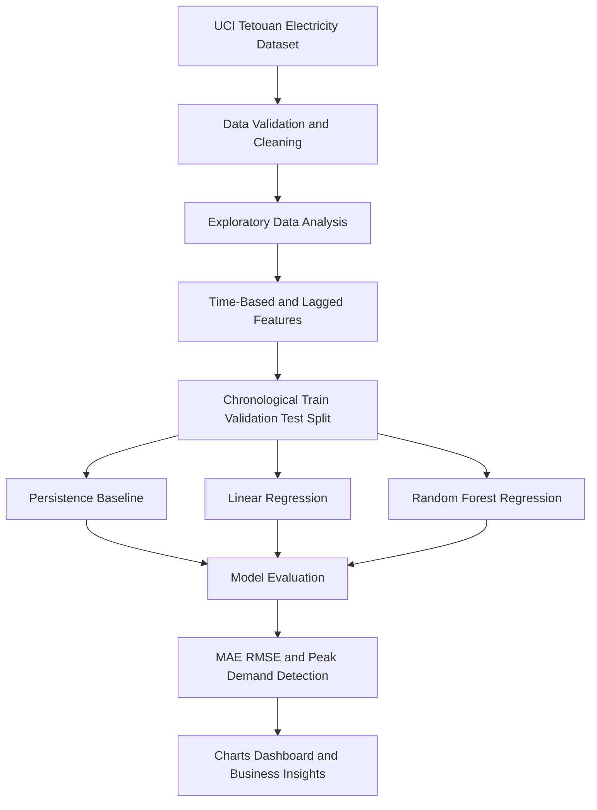

# Project Architecture

## Project Title
Predicting Peak Electricity Demand to Support Operational Planning

## High-Level Architecture Diagram

## Architecture Description

### 1. Data Source
The project uses the publicly available Power Consumption of Tetouan City dataset from the UCI Machine Learning Repository. It contains historical electricity consumption measurements for three distribution zones alongside weather-related variables.

### 2. Data Preparation
Python and Pandas will be used to inspect timestamps, check data quality, prepare variables and create features using only information available at the forecast time.

### 3. Exploratory Data Analysis
Consumption patterns will be examined by time and distribution zone. Weather relationships and potential peak-demand periods will also be investigated.

### 4. Predictive Modelling
A persistence baseline, Linear Regression and Random Forest Regression will be compared for one-hour-ahead electricity demand forecasting. Data will be divided chronologically to avoid future information leaking into model training.

### 5. Model Evaluation
Forecasting performance will be evaluated using Mean Absolute Error (MAE) and Root Mean Squared Error (RMSE). The ability to identify high-demand periods will also be assessed.

### 6. Presentation of Results
The project will present model comparisons, demand patterns and forecast results using charts and a simple dashboard to support operational planning.

## Project Status
This architecture represents the proposed workflow for the Capstone Project. Predictive models and the dashboard have not yet been implemented.
