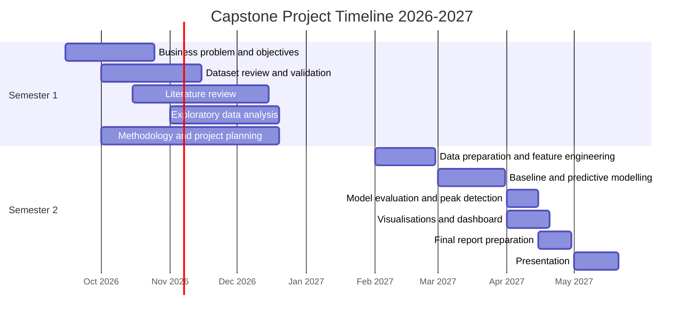

# Project Timeline

## Project Title
Predicting Peak Electricity Demand to Support Operational Planning

## Project Duration
September 2026 – August 2027 (two academic semesters).

The timeline below presents the proposed stages of the Capstone Project. Dates may be adjusted to match the official academic calendar and assessment deadlines.

## Gantt Chart

## Semester 1: Research and Planning
- Define the business problem and SMART objectives.
- Review and document the public dataset.
- Conduct a literature review of electricity demand forecasting.
- Explore electricity consumption and weather patterns.
- Plan the forecasting methodology and evaluation strategy.

## Semester 2: Implementation and Evaluation
- Prepare time-based and lagged forecasting features.
- Train persistence baseline, Linear Regression and Random Forest models.
- Evaluate one-hour-ahead forecasts using MAE and RMSE.
- Assess the identification of peak-demand periods.
- Develop visualisations and a simple dashboard.
- Complete the final report and presentation.

## Planned Deliverables
1. Capstone project proposal.
2. Documented dataset and exploratory analysis.
3. Reproducible Python notebooks.
4. Comparative forecasting model evaluation.
5. Charts and a simple dashboard.
6. Final report and presentation.

## Planning Note
This is a proposed academic timeline, not a record of completed work. The actual implementation schedule will depend on module requirements and lecturer guidance.
